# f(x)orms

[](https://github.com/fvarrui/fxorms/releases/latest)
[](https://fvarrui.github.io/fxorms/)
[](LICENSE)

**f(x)orms builds JavaFX forms from your beans at runtime.** Point it at a class with JavaFX properties and you get a form with a labelled control per property, bound in both directions to the object you're editing.

```java
Form<Person> form = new FormBuilder<>(Person.class).build();
form.bind(person);
```

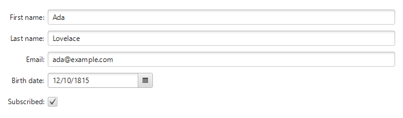

## Contents

- [Features](#features)
- [Installation](#installation)
- [Quick start](#quick-start)
- [How it works](#how-it-works)
- [Use cases](#use-cases)
- [Supported types](#supported-types)
- [Annotations](#annotations)
- [Custom adapters](#custom-adapters)
- [Styling](#styling)
- [Java modules](#java-modules)
- [API documentation](#api-documentation)
- [Building from source](#building-from-source)

## Features

- **No form code.** One row per property, inherited ones included, with a control chosen by type.
- **Two-way binding.** Edits update the bean and bean changes show up in the form. One form can be rebound to other objects at any time.
- **Read-only properties.** Use `@ReadOnly`, or expose a `ReadOnlyXxxProperty`. They're greyed out, and their text can still be copied.
- **Input validation.** Numbers and dates that can't be parsed are marked in red and never reach the bean.
- **Annotations** for labels, order, formats and multi-line text.
- **Extensible.** Plug in your own adapters to render any type, or to change how a type is rendered.
- **Plain JavaFX.** A form is a `GridPane` you can put anywhere and style with CSS.

## Installation

Requirements: Java 17+ and JavaFX 21+. f(x)orms doesn't bring JavaFX: your application provides `javafx-controls` and `javafx-fxml`.

Maven:

```xml
<dependency>
    <groupId>io.github.fvarrui</groupId>
    <artifactId>fxorms</artifactId>
    <version>0.1.0</version>
</dependency>
```

Gradle:

```groovy
implementation 'io.github.fvarrui:fxorms:0.1.0'
```

> Maven Central publication of 0.1.0 is pending. Meanwhile, download `fxorms-0.1.0.jar` from the [releases page](https://github.com/fvarrui/fxorms/releases/latest).

## Quick start

**1. Write a JavaFX bean.** f(x)orms only needs the `xxxProperty()` accessors; getters and setters are up to you.

```java
public class Person {

    private final StringProperty firstName = new SimpleStringProperty();
    private final StringProperty lastName = new SimpleStringProperty();
    private final StringProperty email = new SimpleStringProperty();
    private final ObjectProperty<LocalDate> birthDate = new SimpleObjectProperty<>();
    private final BooleanProperty subscribed = new SimpleBooleanProperty();

    public StringProperty firstNameProperty() { return firstName; }
    public StringProperty lastNameProperty() { return lastName; }
    public StringProperty emailProperty() { return email; }
    public ObjectProperty<LocalDate> birthDateProperty() { return birthDate; }
    public BooleanProperty subscribedProperty() { return subscribed; }

    // getters, setters, constructors...
}
```

**2. Build a form, bind an object and show it.**

```java
public class QuickStart extends Application {

    @Override
    public void start(Stage stage) {
        Person person = new Person("Ada", "Lovelace", "ada@example.com", LocalDate.of(1815, 12, 10), true);

        Form<Person> form = new FormBuilder<>(Person.class).build();
        form.bind(person);

        stage.setScene(new Scene(form));
        stage.show();
    }

}
```

The result is the form at the top of this page. Whatever the user types goes straight into `person`, and changes made to `person` from code show up in the form.

## How it works

- **Properties.** Every public `xxxProperty()` method returning a JavaFX property becomes a row, including the ones inherited from superclasses.
- **Labels.** Generated from the property name: `firstName` becomes "First name", `userID` becomes "User ID". Use `@Label` to change them.
- **Order.** Rows follow the order in which the fields are declared, superclass fields first. Use `@Order` to change it.
- **Controls.** Each row's control is chosen by the property type; see [Supported types](#supported-types).
- **Binding.** `form.bind(bean)` connects the controls to that object's properties, after disconnecting the previous one. `form.unbind()` disconnects it, and `form.getBean()` returns the bound object.
- **Access to controls.** `form.getControl("email")` returns the control built for a property (named after its accessor, `emailProperty()`), for example to focus it or add a tooltip.

## Use cases

The code of every example is in [`src/test/java/io/github/fvarrui/fxorms/examples`](src/test/java/io/github/fvarrui/fxorms/examples). Run [`ExamplesApp`](src/test/java/io/github/fvarrui/fxorms/examples/ExamplesApp.java) from your IDE to try them all.

### Edit an object in a dialog, with OK and Cancel

Bind the form to a copy, and copy the changes back only when the user clicks OK.

```java
Person draft = new Person();
draft.copyFrom(person);

Dialog<ButtonType> dialog = new Dialog<>();
dialog.setHeaderText("Edit contact");
dialog.getDialogPane().setContent(new FormBuilder<>(Person.class).build().bind(draft));
dialog.getDialogPane().getButtonTypes().addAll(ButtonType.OK, ButtonType.CANCEL);

if (dialog.showAndWait().filter(ButtonType.OK::equals).isPresent()) {
    person.copyFrom(draft);
}
```

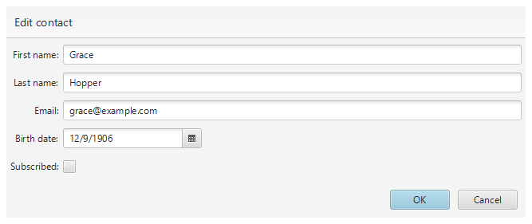

### Master-detail: one form for many objects

Build the form once and rebind it whenever the selection changes. The previous object is unbound automatically, so it stops receiving edits.

```java
ListView<Person> list = new ListView<>(people);
Form<Person> form = new FormBuilder<>(Person.class).build();

list.getSelectionModel().selectedItemProperty().addListener((o, previous, selected) -> form.bind(selected));
```

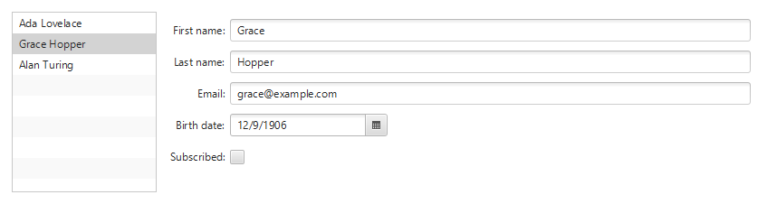

### Read-only and computed values

`@ReadOnly` locks a property that is writable in the bean. A property exposed only as `ReadOnlyXxxProperty` is always read-only, and the form keeps showing its latest value when your code changes it. Read-only text fields are greyed out, but their text can still be selected and copied.

```java
public class Account {

    @ReadOnly
    private final IntegerProperty id = new SimpleIntegerProperty();
    private final StringProperty username = new SimpleStringProperty();
    private final ObjectProperty<Status> status = new SimpleObjectProperty<>(Status.ACTIVE);
    private final ReadOnlyObjectWrapper<LocalDateTime> createdAt = new ReadOnlyObjectWrapper<>();
    private final ReadOnlyIntegerWrapper logins = new ReadOnlyIntegerWrapper();

    public IntegerProperty idProperty() { return id; }
    public StringProperty usernameProperty() { return username; }
    public ObjectProperty<Status> statusProperty() { return status; }
    public ReadOnlyObjectProperty<LocalDateTime> createdAtProperty() { return createdAt.getReadOnlyProperty(); }
    public ReadOnlyIntegerProperty loginsProperty() { return logins.getReadOnlyProperty(); }

    public void login() {
        logins.set(logins.get() + 1);   // the "Logins" row is updated
    }

}
```

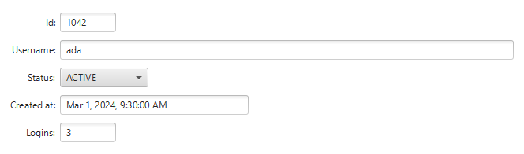

### Labels, order, formats and multi-line text

```java
public class Product {

    public enum Category { BOOKS, ELECTRONICS, GARDEN, TOYS }

    private final StringProperty name = new SimpleStringProperty();
    @Multiline(rows = 3)
    private final StringProperty description = new SimpleStringProperty();
    @Order(0)
    @Label("SKU")
    private final StringProperty code = new SimpleStringProperty();
    private final ObjectProperty<Category> category = new SimpleObjectProperty<>();
    @Format("#,##0.00")
    private final DoubleProperty price = new SimpleDoubleProperty();
    @Label("Units in stock")
    private final IntegerProperty stock = new SimpleIntegerProperty();
    @Format("yyyy-MM-dd HH:mm")
    private final ObjectProperty<LocalDateTime> availableFrom = new SimpleObjectProperty<>();

    // xxxProperty() accessors...
}
```

`SKU` comes first because of `@Order(0)`, the description is a text area, the price has two decimals and the category is a combo box with the enum constants.

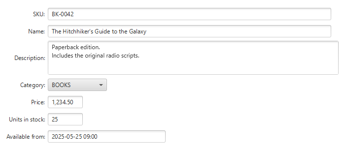

### Input validation

Numbers and date-times are typed as text. When the text can't be converted, the field turns red and the bean keeps its last valid value; the mark goes away as soon as the text is valid again. Integers are shown without thousands separators, and date-times keep their seconds.

```java
TextField stock = (TextField) form.getControl("stock");
stock.setText("25 units");     // what a user might type

product.getStock();            // still 25
```

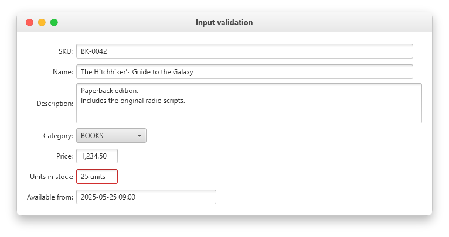

### Lists and maps

List and map properties get editors that work on the bean's own collections: removing a row removes the item from the bean, and items added by your code show up in the editor.

```java
public class Project {

    private final StringProperty name = new SimpleStringProperty();
    private final ListProperty<Object> tags = new SimpleListProperty<>(FXCollections.observableArrayList());
    private final MapProperty<String, Object> settings = new SimpleMapProperty<>(FXCollections.observableHashMap());

    // xxxProperty() accessors...
}
```

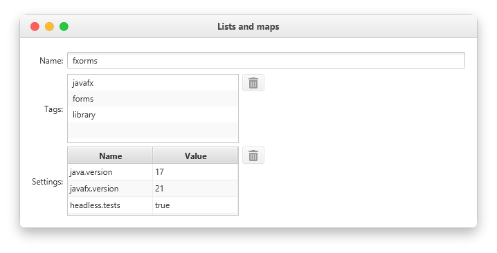

### Inheritance

Properties inherited from a superclass are included, and come first.

```java
public class Employee extends Person {

    private final StringProperty department = new SimpleStringProperty();
    @Format("#,##0.00")
    private final DoubleProperty salary = new SimpleDoubleProperty();

    public StringProperty departmentProperty() { return department; }
    public DoubleProperty salaryProperty() { return salary; }

}
```

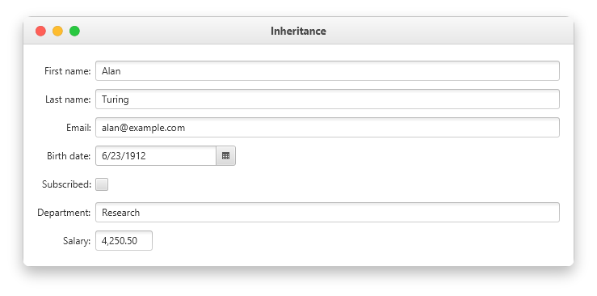

### Your own controls

Types without a built-in control, such as `ObjectProperty<Color>`, can get one with a [custom adapter](#custom-adapters). With a custom annotation, an adapter can also change the control of only some properties: here, numbers annotated with `@Range` become sliders.

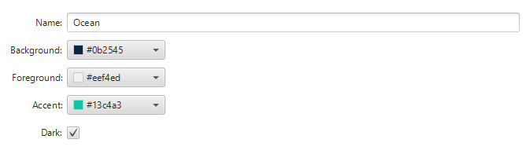

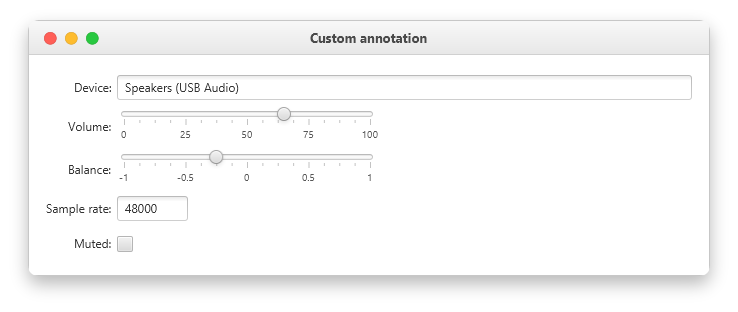

### Styling

Forms have the `form` style class, so they can be restyled with your own stylesheet. See [Styling](#styling).

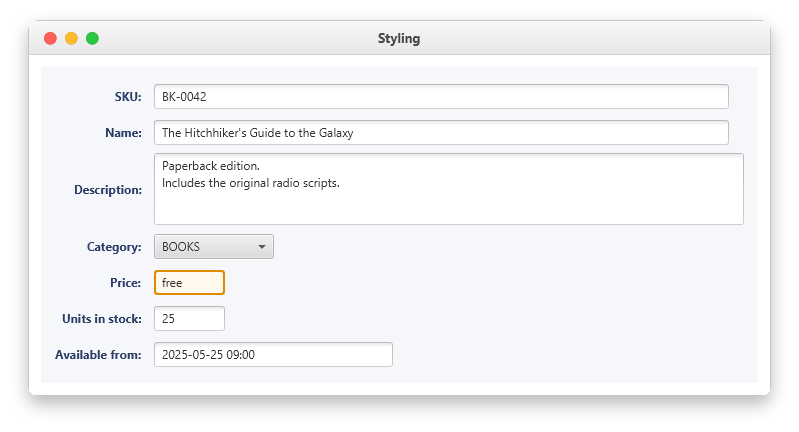

## Supported types

| Property type | Control |
| --- | --- |
| `StringProperty` | `TextField`, or `TextArea` with `@Multiline` |
| `IntegerProperty`, `LongProperty` | `TextField`, no thousands separator, invalid input marked |
| `DoubleProperty`, `FloatProperty` | `TextField` with the locale's number format, invalid input marked |
| `BooleanProperty` | `CheckBox` |
| `ObjectProperty<LocalDateTime>` | `TextField` with the locale's date-time format (with seconds), invalid input marked |
| `ObjectProperty<LocalDate>` | `DatePicker` |
| `ObjectProperty<SomeEnum>` | `ComboBox` with the enum's constants |
| `ListProperty<Object>` | List editor that can remove items |
| `MapProperty<String, Object>` | Table editor that can remove entries |

Read-only versions (`ReadOnlyStringProperty`, …) get the same controls, read-only. Any other type is shown as text in a read-only label, unless you add a [custom adapter](#custom-adapters).

## Annotations

Put them on the property's field or on its `xxxProperty()` accessor.

| Annotation | Effect |
| --- | --- |
| `@ReadOnly` | The row can't be edited |
| `@Label("E-mail address")` | Row label, instead of the one generated from the name |
| `@Order(0)` | Row position; rows with an order come first, lowest first |
| `@Format("#,##0.00")` | Number pattern (`DecimalFormat`) |
| `@Format("yyyy-MM-dd HH:mm")` | Date-time or date pattern (`DateTimeFormatter`) |
| `@Multiline(rows = 5)` | Text area instead of a text field |

## Custom adapters

An adapter decides which properties it renders, builds their control and binds it to the bean. Extend `ObjectAdapter` for `ObjectProperty<X>` types, or `FieldAdapter` for anything else, and register it on the builder.

```java
public class ColorAdapter extends ObjectAdapter<ColorPicker, ObservableValue<Color>> {

    public ColorAdapter() {
        super(Color.class);   // handles ObjectProperty<Color>
    }

    @Override
    public ColorPicker build(BeanProperty property) {
        ColorPicker control = new ColorPicker();
        control.setDisable(isReadOnly(property));   // @ReadOnly or read-only accessor
        return control;
    }

    @Override
    public void doBind(ColorPicker control, ObservableValue<Color> property) {
        bindValue(control.valueProperty(), property);   // two-way, or one-way if read-only
    }

    @Override
    public void doUnbind(ColorPicker control, ObservableValue<Color> property) {
        unbindValue(control.valueProperty(), property);
    }

}
```

```java
Form<Theme> form = new FormBuilder<>(Theme.class)
        .registerFieldAdapter(new ColorAdapter())
        .build();
```

To handle only some properties, override `isPropertyType`. This adapter turns into sliders only the numbers annotated with a custom `@Range`, and leaves the rest to the built-in text field:

```java
@Retention(RetentionPolicy.RUNTIME)
@Target({ ElementType.FIELD, ElementType.METHOD })
public @interface Range {
    double min();
    double max();
}

public class SliderAdapter extends FieldAdapter<Slider, ObservableValue<Number>> {

    public SliderAdapter() {
        super(ReadOnlyIntegerProperty.class, ReadOnlyDoubleProperty.class);
    }

    @Override
    public boolean isPropertyType(BeanProperty property) {
        return super.isPropertyType(property) && property.getAnnotation(Range.class) != null;
    }

    @Override
    public Slider build(BeanProperty property) {
        Range range = property.getAnnotation(Range.class);
        Slider slider = new Slider(range.min(), range.max(), range.min());
        slider.setShowTickLabels(true);
        slider.setDisable(isReadOnly(property));
        return slider;
    }

    @Override
    public void doBind(Slider control, ObservableValue<Number> property) {
        bindValue(control.valueProperty(), property);
    }

    @Override
    public void doUnbind(Slider control, ObservableValue<Number> property) {
        unbindValue(control.valueProperty(), property);
    }

}
```

Good to know:

- **Precedence.** Your adapters are tried before the built-in ones, and the last one registered wins. Keep them as specific as possible, or they'll hide the built-in ones.
- **Per builder.** Adapters are registered on each `FormBuilder`, not globally.
- **Shared instance.** One adapter instance serves every form and property of its builder, so don't keep per-control state in its fields; use `control.getProperties()`.
- **Text input.** For values typed as text, bind with `TextBinding` and a `StringConverter` that throws on invalid text: the field gets marked red like the built-in ones.

## Styling

A form is a `GridPane` with the `form` style class: row labels are its direct `.label` children, inputs that can't be converted have the `:invalid` pseudo-class (red by default), and read-only text inputs have `:readonly` (grey by default). Add your own stylesheet to the form or to the scene:

```java
form.getStylesheets().add(getClass().getResource("forms.css").toExternalForm());
```

```css
.form {
    -fx-background-color: #f5f7fb;
    -fx-hgap: 12;
    -fx-vgap: 6;
    -fx-padding: 14;
}

.form > .label {
    -fx-font-weight: bold;
    -fx-text-fill: #2c3e66;
}

.form .text-input:invalid {
    -fx-background-color: #e08a00, #fff8ec;
    -fx-background-insets: 0, 2;
}
```

## Java modules

f(x)orms is the named module `io.github.fvarrui.fxorms`. If your application is a named module too, export the packages of your beans to it, because forms call the beans' accessors:

```java
module com.example.app {
    requires io.github.fvarrui.fxorms;
    exports com.example.model to io.github.fvarrui.fxorms;
}
```

## API documentation

The Javadoc of the latest release is at **[fvarrui.github.io/fxorms](https://fvarrui.github.io/fxorms/)**.

## Building from source

```bash
mvn test                       # headless test suite
mvn compile javadoc:javadoc    # API docs in target/reports/apidocs
mvn package                    # jar in target/
```

The screenshots in this README are generated from the examples with `mvn test -Dtest=ScreenshotsTest -Dscreenshots=true`.

## License

[GNU General Public License v3.0](LICENSE)
