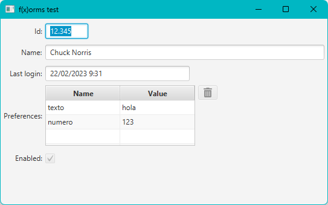

# f(x)orms

 JavaFX form builder.

## Installation

Add the dependency to your project. JavaFX isn't included: your application brings its own (`javafx-controls` and `javafx-fxml` 21 or later).

```xml
<dependency>
    <groupId>io.github.fvarrui</groupId>
    <artifactId>fxorms</artifactId>
    <version>0.1.0</version>
</dependency>
```

Gradle: `implementation 'io.github.fvarrui:fxorms:0.1.0'`

## How to build a form

1. Create your JavaFX bean:
   
   ```java
   public class User {
   
       @ReadOnly
       private IntegerProperty id = new SimpleIntegerProperty();
   
       private StringProperty name = new SimpleStringProperty();
   
       @ReadOnly
       private ObjectProperty<LocalDateTime> lastLogin = new SimpleObjectProperty<>();
   
       private MapProperty<String, Object> preferences = new SimpleMapProperty<>(FXCollections.observableHashMap());
   
       private ReadOnlyBooleanWrapper enabled = new ReadOnlyBooleanWrapper();
   
       public final IntegerProperty idProperty() {
           return this.id;
       }
   
       public final int getId() {
           return this.idProperty().get();
       }
   
       public final void setId(final int id) {
           this.idProperty().set(id);
       }
   
       public final StringProperty nameProperty() {
           return this.name;
       }
   
       public final String getName() {
           return this.nameProperty().get();
       }
   
       public final void setName(final String name) {
           this.nameProperty().set(name);
       }
   
       public final ObjectProperty<LocalDateTime> lastLoginProperty() {
           return this.lastLogin;
       }
   
       public final LocalDateTime getLastLogin() {
           return this.lastLoginProperty().get();
       }
   
       public final void setLastLogin(final LocalDateTime lastLogin) {
           this.lastLoginProperty().set(lastLogin);
       }
   
       public final MapProperty<String, Object> preferencesProperty() {
           return this.preferences;
       }
   
       public final ObservableMap<String, Object> getPreferences() {
           return this.preferencesProperty().get();
       }
   
       public final void setPreferences(final ObservableMap<String, Object> preferences) {
           this.preferencesProperty().set(preferences);
       }
   
       public final javafx.beans.property.ReadOnlyBooleanProperty enabledProperty() {
           return this.enabled.getReadOnlyProperty();
       }
   
       public final boolean isEnabled() {
           return this.enabledProperty().get();
       }
   
   }
   ```

2. Build your form at runtime:
   
   ```java
   Form<User> form = new FormBuilder<>(User.class).build();
   ```

> You can register your own custom adapters with `registerFieldAdapter(x)` method to render the bean properties as specific UI components.

4. Add it to your view:
   
   ```java
   stage.setTitle("f(x)orms test");
   stage.setScene(new Scene(form));
   stage.show();
   ```

5. Bind a bean to the form:
   
   ```java
   User user = new User();
   [...]
   form.bind(user);
   ```

    A this is the result:

    

## Requirements

- Java 17+ and JavaFX 21+.
- Each bean property must have a public accessor following the JavaFX convention: `public StringProperty nameProperty()`. Inherited properties are included. If the accessor returns a `ReadOnlyXxxProperty`, the row is read-only.

## Supported types

| Property type | Control |
| --- | --- |
| `StringProperty` | `TextField`, or `TextArea` with `@Multiline` |
| `IntegerProperty`, `LongProperty`, `DoubleProperty`, `FloatProperty` | `TextField` that marks invalid numbers |
| `BooleanProperty` | `CheckBox` |
| `ObjectProperty<LocalDateTime>` | `TextField` that marks invalid date-times |
| `ObjectProperty<LocalDate>` | `DatePicker` |
| `ObjectProperty<SomeEnum>` | `ComboBox` with the enum's constants |
| `ListProperty<Object>` | List editor |
| `MapProperty<String, Object>` | Map editor |

Any other type is shown as a read-only label, unless you register your own adapter with `registerFieldAdapter(adapter)`. Your adapters take precedence over the built-in ones.

## Annotations

Put them on the property's accessor or on its backing field:

- **`@ReadOnly`.** The row can't be edited.
- **`@Multiline(rows = 5)`.** Text area instead of a text field.
- **`@Format("#,##0.00")`.** Number or date-time pattern (`DecimalFormat` or `DateTimeFormatter`).
- **`@Label("E-mail address")`.** Row label, instead of the one generated from the property name.
- **`@Order(1)`.** Row position. Rows with an order come first; the rest follow their declaration order.

## Java modules

If your application is a named module, export your bean packages to f(x)orms, because forms call the beans' accessors:

```java
module com.example.app {
    requires io.github.fvarrui.fxorms;
    exports com.example.model to io.github.fvarrui.fxorms;
}
```
